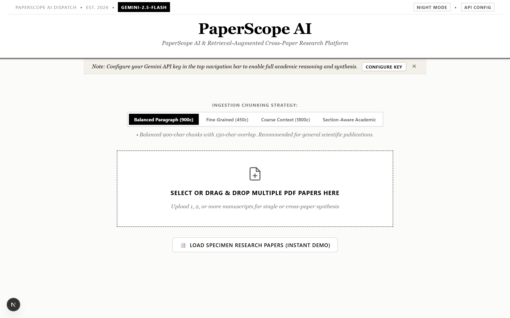
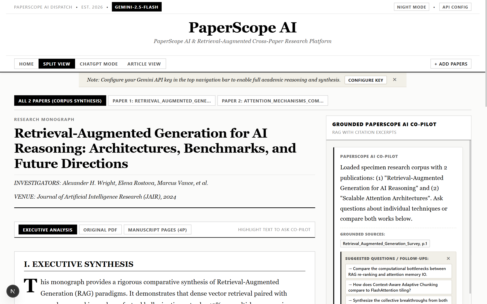
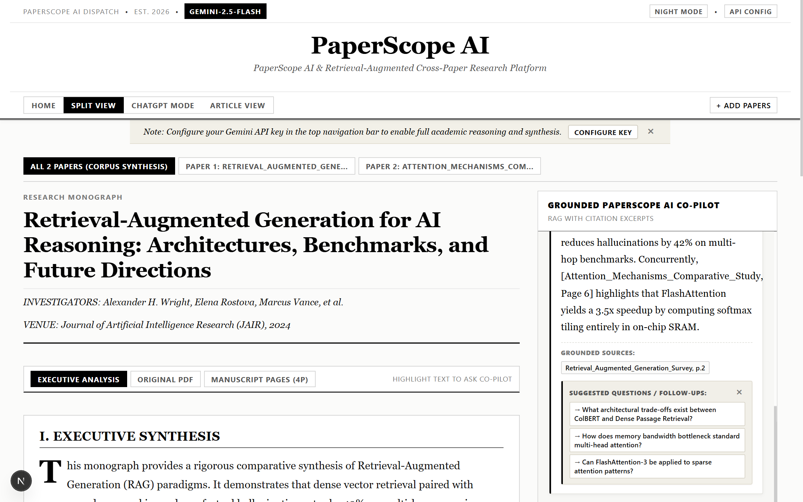
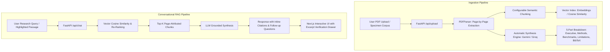

# PaperScope AI — Enterprise Academic Research Paper Analyser

[](https://nextjs.org/)
[](https://fastapi.tiangolo.com/)
[](https://ai.google.dev/)
[](https://groq.com/)
[](https://www.typescriptlang.org/)
[](https://www.python.org/)
[](https://www.docker.com/)
[](LICENSE)

An enterprise-grade, full-stack Retrieval-Augmented Generation (RAG) platform purpose-built for academic literature synthesis, multi-document cross-examination, and verifiable citation interrogation.

---

## Application Walkthrough

### Stage 1: Document Ingestion & Workspace Setup
Configure semantic chunking profiles, select inference models, and ingest single or multi-manuscript research corpuses via drag-and-drop or one-click specimen loading.



* **Adaptive Chunking Engine**: Choose between Balanced Paragraph (900c), Fine-Grained Passage (450c), Coarse Context (1800c), or Section-Aware Academic isolation.
* **Instant Specimen Mode**: Explore sample research corpuses immediately without requiring an initial file upload.
* **Model & Session Configuration**: Enter API keys in-browser or run securely against backend environment variables.

---

### Stage 2: Split-Screen Academic Synthesis
View automated 5-part academic breakdowns alongside document metadata, publication venues, and one-click citation exports.



* **Automated 5-Part Breakdown**: Instant structured synthesis extracting Executive Summary, Key Contributions, Methodology & Design, Empirical Benchmarks, and Documented Limitations.
* **Multi-Paper Corpus Switcher**: Switch between individual paper monographs or analyze the unified multi-document corpus.
* **Tri-Mode Reader**: Toggle between Executive Analysis, Embedded Original PDF, and Page-by-Page Manuscript views.
* **BibTeX Generator**: Instant copyable BibTeX entry formatted to academic standards.

---

### Stage 3: Conversational RAG Interrogation & Citation Attribution
Conduct deep conversational inquiries with verified page-level source citations and interactive excerpt inspection.



* **Grounded Source Attribution**: Every response includes clickable `[Page X]` citation chips linking to original manuscript excerpts.
* **Archival Excerpt Verification**: Click any citation chip to open a verification drawer displaying verbatim excerpt text and relevance confidence scoring.
* **Proactive Follow-Ups**: Proactively suggests domain-specific cross-examination questions based on conversation context.
* **Text Selection Interrogation**: Highlight any passage in the manuscript to ask targeted questions directly against that section.

---

## Core Capabilities

| Capability | Description |
|---|---|
| **Multi-Document Synthesis** | Ingest multiple papers simultaneously to perform cross-document comparisons, synthesize conflicting methodologies, and discover cross-paper citations. |
| **Verifiable In-Text Citations** | Eliminates hallucination risk with strict source grounding, inline citation chips, and relevance scores. |
| **Configurable Chunking Profiles** | Tailor token segmentation to the paper's domain — fine-grained for metric ablation tables or coarse for mathematical proofs. |
| **Multi-Model Intelligence** | Switch on the fly between Google Gemini (Gemini 2.5 Flash, 1.5 Pro) and Groq (Llama 3.3 70B Versatile). |
| **Flexible Workspace Layouts** | Work in Dual-Pane Split View, focused ChatGPT Mode, Reading Article View, or Full Original PDF Mode. |
| **Session Isolation & Privacy** | Multi-tenant session isolation keeps paper indices separate per user with optional client-side API key storage. |
| **Editorial Newspaper Aesthetic** | Designed with high-readability typography, obsidian dark mode toggle, and micro-animations. |

---

## System Architecture



---

## Quick Start Guide

### Prerequisites
* **Node.js**: v18+ (tested on Node.js v24)
* **Python**: 3.9+ (tested on Python 3.13)
* **API Keys (Optional)**: [Google AI Studio (Gemini)](https://aistudio.google.com/app/apikey) or [Groq Console](https://console.groq.com/keys). *Keys can also be entered directly in the web UI!*

---

### Option 1: Run with Docker Compose (Recommended)

Run the entire full-stack application with a single command:

```bash
docker compose up --build
```

* **Frontend**: `http://localhost:3000`
* **Backend API**: `http://localhost:8000`

---

### Option 2: Local Development Setup

#### 1. Backend Setup (FastAPI)

```bash
cd backend

# Install dependencies
python -m pip install -r requirements.txt

# (Optional) Copy environment template
cp .env.example .env

# Start FastAPI dev server (port 8001)
python main.py
```

The interactive OpenAPI documentation is available at `http://localhost:8001/docs`.

#### 2. Frontend Setup (Next.js)

```bash
cd frontend

# Install dependencies
npm install

# Start Next.js development server (port 3000)
npm run dev
```

Open your browser at `http://localhost:3000`.

---

## Environment Configuration

### Backend (`backend/.env`)

| Variable | Description | Default |
|---|---|---|
| `PORT` | FastAPI server port | `8001` |
| `HOST` | Bind host address | `0.0.0.0` |
| `GOOGLE_API_KEY` | Google Gemini API key (optional if provided in UI) | `""` |
| `GROQ_API_KEY` | Groq API key for Llama 3 models (optional) | `""` |

### Frontend (`frontend/.env.local`)

| Variable | Description | Default |
|---|---|---|
| `NEXT_PUBLIC_BACKEND_URL` | Base URL pointing to the FastAPI backend | `http://localhost:8001` |

---

## API Reference

| Endpoint | Method | Description |
|---|---|---|
| `/api/upload` | `POST` | Upload PDF files with chunking strategy & session tracking. Returns parsed metadata and 5-part synthesis. |
| `/api/chat` | `POST` | Query paper corpus with conversational history, highlighted text, and retrieve grounded responses with citations. |
| `/api/paper/{paper_id}/pdf` | `GET` | Stream original PDF file for the embedded browser reader. |
| `/api/paper/{paper_id}` | `DELETE` | Remove a paper from the active user session index. |
| `/api/health` | `GET` | Service health status and active session counts. |

---

## Cloud Deployment

### Deploying Frontend to Vercel
1. Push repository to GitHub.
2. In [Vercel](https://vercel.com), select **"Add New Project"** and import the repository.
3. Set **Root Directory** to `frontend`.
4. Configure environment variable:
   * `NEXT_PUBLIC_BACKEND_URL`: URL of your deployed FastAPI backend (e.g., `https://your-api.onrender.com`).
5. Click **Deploy**.

### Deploying Backend to Render / Railway
1. In Render, create a **"New Web Service"** and connect your repository.
2. Set **Root Directory** to `backend`.
3. Set **Runtime** to `Python 3`.
4. Set **Build Command**: `pip install -r requirements.txt`.
5. Set **Start Command**: `uvicorn main:app --host 0.0.0.0 --port $PORT`.
6. Add environment variables:
   * `GOOGLE_API_KEY`: Your Gemini API key.
   * `GROQ_API_KEY`: Your Groq API key (optional).

---

## License

This project is licensed under the MIT License — see the [LICENSE](LICENSE) file for details.
